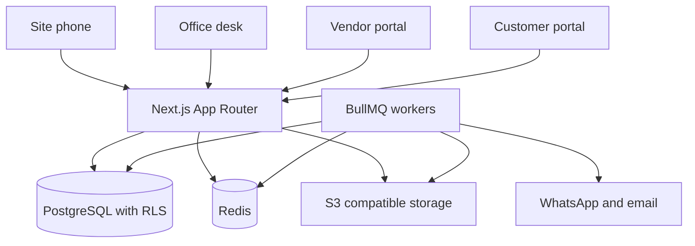
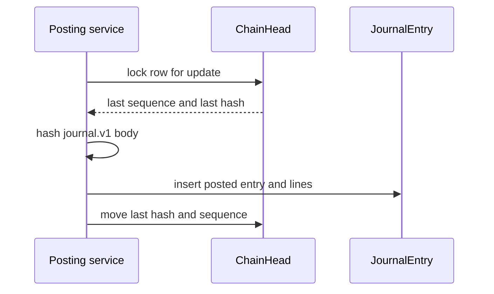
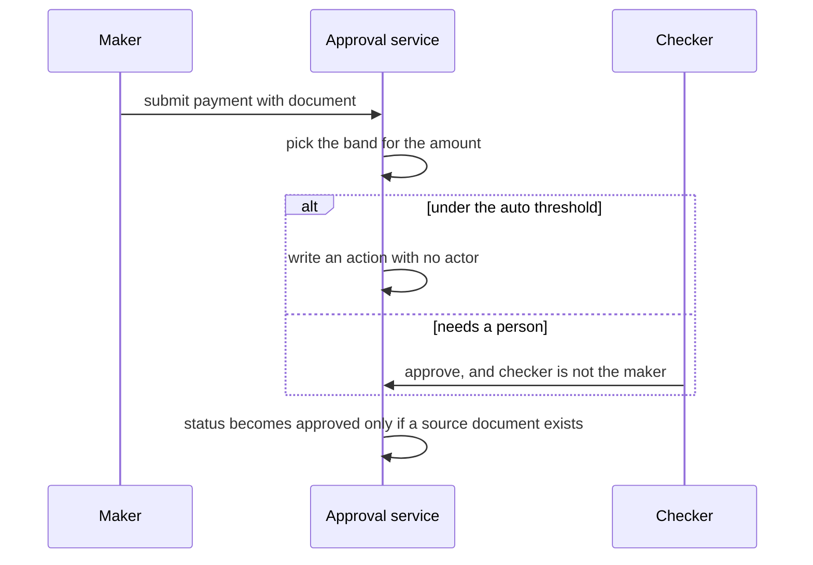
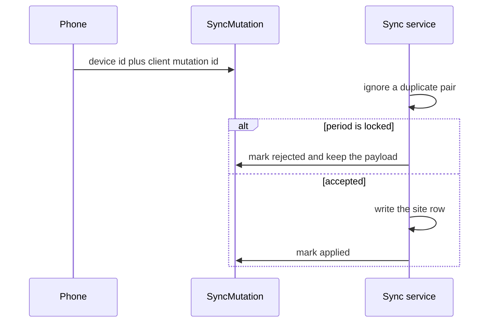

# SiteLedger architecture

Step 1 of the product brief in [SPEC.md](./SPEC.md). This document is the system design, the folder map, and the rules the database and the formula code already follow. The entity diagram is in [ER.md](./ER.md). The field-complete model is `prisma/schema.prisma`.

Step 1 is the design below. Step 3, now in the repo, applies that design: auth, the eight roles, row-level security, the audit log, maker-checker, locked periods, and the hash-chain helpers. Module screens are still later. Postgres for this step is the `postgres` service in `docker-compose.yml`.

The worked examples use a made-up firm, Red Earth Developers, and a made-up Hyderabad project, Saffron Heights. The GSTIN `36AAAAA0000A1Z3` is a shape-and-checksum example for that fiction. It is not a registered taxpayer.

## 1. What this step ships

| Piece | Where | Status |
| --- | --- | --- |
| Product brief, saved verbatim | `docs/SPEC.md` | written |
| This design | `docs/ARCHITECTURE.md` | written |
| Mermaid entity diagrams | `docs/ER.md` | written |
| Prisma schema, 112 models | `prisma/schema.prisma` | validates |
| Row-level security, immutability, checks, views | `prisma/sql/*.sql` | applied by the step 3 migration |
| Money, GST, share, and hash functions | `src/lib/**` | tested |
| Auth, audit middleware, approvals, periods, hash helpers | `src/server/**` | tested against Postgres |
| Next.js 14 status page and sign-in | `src/app/page.tsx`, `src/app/sign-in` | step 3 |

The migration `20261025120100_security` runs `prisma/sql/rls.sql`, `immutability.sql`, `checks.sql`, and `views.sql` unchanged, then adds the local app login and the chain-head functions.

## 2. System context



The App Router serves the office, the site, and both portals from one codebase. A request sets four session values before any business query: `app.organization_id`, `app.user_id`, `app.role`, and `app.party_id`. PostgreSQL row-level security uses those values. The application is a second check, not the only one.

Redis and S3 are drawn because the brief requires them. They are not wired in this step. Jobs that will use them later: bank-statement match, OCR, Tally import, WhatsApp and email, and offline sync.

## 3. Tenancy and roles

Every business table carries `organization_id`. Six tables are global and have no tenant column:

- `users`, `auth_accounts`, `auth_sessions`, `auth_verification_tokens` (Auth.js)
- `gst_rates`, `tds_sections` (statutory reference data)

A person is a `User`. A firm is an `Organization`. A `Membership` joins them with one role. The same person can belong to more than one firm. Vendor and customer memberships must point at a `Party`. Finance, project manager, site engineer, sales, and auditor memberships must not. An owner may point at a party only as a shortcut to “my partner ledger”. That pointer does not limit what the owner can see.

| Role | Sees | Writes |
| --- | --- | --- |
| Owner | The whole firm | Yes, including period reopen |
| Finance | The whole firm | Yes, except period reopen |
| Project manager, site engineer, sales | Assigned projects only | Yes, inside those projects |
| Vendor portal | That vendor’s orders, invoices, and payments | Invoice upload |
| Customer portal | That buyer’s unit, demands, receipts, documents, and published photos | No |
| Auditor | The whole firm, including soft-deleted rows | No, except an export row in the audit log |

Project scope is enforced in the database, not only in the app. `app.project_allowed(project_id)` is `SECURITY DEFINER` so it can read `project_assignments` without tripping row-level security on itself. Owner, finance, and auditor do not consult that table.

Postgres combines permissive policies with OR and restrictive policies with AND. Each tenant table gets:

1. A permissive policy: the row’s `organization_id` equals the session firm.
2. A restrictive project policy, on tables that have `project_id`.
3. A restrictive portal policy, so a vendor or customer falls closed to their own party.
4. A restrictive write policy that rejects an auditor, and rejects a session that has no role.

The application role `siteledger_app` is not the table owner and has no `DELETE` grant. Row-level security is enabled and not forced, so the migration owner can still maintain the database. Soft-deleted rows stay in the table. Screens hide them. The auditor can still open them.

`created_by_id` and `updated_by_id` are plain uuids on most rows. The actor who matters for a domain event (approver, measurer, poster, recorder) is a real foreign key. `AuditEvent.actor_id` is the enforced actor for the trail. This avoids a Prisma relation from every table back to `User`.

## 4. Money, area, tax, and language

Money is integer paise. ₹1 is 100 paise. Rates are rupees as `Decimal(18,4)`. Areas are square feet as `Decimal(14,3)`. A percent such as 18.0000 means 18 percent, stored as `Decimal(8,4)`.

Rounding is half away from zero, implemented with `decimal.js` in `src/lib/money/rounding.ts`. Display will use lakh and crore grouping. The stored value never does.

Documents snapshot the GST percents and the paise they charged. A later change to `gst_rates` does not rewrite history.

Labels on non-finance screens stay in plain language (“money in”, “money still due”). Ledger words stay on the finance screens. `User.locale` and `Organization.locale` accept English, Telugu, Hindi, and Kannada. Translation tables are not in this version.

The firm’s timezone defaults to `Asia/Kolkata`. A weekend test uses the payment’s business date in that zone, not the insert timestamp.

## 5. Module boundaries

Each module owns its tables and calls the formula modules. No module invents a second way to round money.

| Module | Owns | Posts money through |
| --- | --- | --- |
| Projects and units | Project, phase, tower, floor, unit, area revisions, cost centres, BOQ | No journal |
| Sales CRM | Lead, follow-up, site visit, booking, agreement, cancellation, transfer, demands, interest, receipts | Receipt, refund, interest journals |
| Partners | Capital, profit-sharing rules, unit allocation, share ledger | Capital and share journals |
| Vendors and procurement | Party KYC, indent, quote, comparison, PO, GRN, invoice, 3-way match | Invoice and payment journals |
| Materials | Stock ledger, issues, wastage | Stock hash chain, not a second money book |
| Contractors and labour | Work order, measurement book, RA bill, retention, advance, recovery, attendance | RA bill, retention, advance journals |
| Finance | Chart of accounts, journals, bank, budget, loans, EMI, Tally map | The only hash-chained money book |
| Documents | Attachment, checksum, OCR fields | No money |
| Exceptions and search | Exception rules and items, Cmd-K projection | No money |

Cash book is a view over posted and reversed journal lines on bank and cash accounts. It is not a second book. Leaving reversed rows out would drop the original and keep only the reversal.

Customer receipts credit Customer Advances, a liability, until possession. They do not credit income on the day the money arrives. The owner dashboard’s “margin” is the commercial figure in section 8. Accounting profit is a separate figure.

## 6. Folder structure

What exists today:

```text
docs/
  SPEC.md
  ARCHITECTURE.md
  ER.md
prisma/
  schema.prisma
  sql/
    rls.sql
    immutability.sql
    checks.sql
    views.sql
scripts/
  check-mermaid.mjs
  check-schema-coverage.mjs
src/
  app/
    layout.tsx
    page.tsx
    globals.css
  lib/
    money/        rounding, interest, EMI, GST split, TDS, wages, stock, BOQ, share
    gst/          GSTIN and PAN shape
    integrity/    journal, stock, share, and audit hashes
    identity/     phone, bank fingerprint, invoice fingerprint
```

Step 3 adds these paths:

```text
src/server/            auth, permission matrix, audit middleware, approvals, periods, journals
src/app/sign-in/       email token sign-in
src/app/api/auth/      session endpoints
docker-compose.yml     PostgreSQL 16
prisma/migrations/     schema, then the security scripts
prisma/seed.ts         Red Earth and Blue Basin, fictional names
```

These paths are still later. The status page does not pretend they are here:

```text
src/app/(app)/projects|sales|partners|vendors|materials|contractors|finance
src/app/(app)/documents|dashboard|exceptions|search
src/app/portal/vendor
src/app/portal/customer
src/components/ui/     shadcn, added with the first real screen
src/jobs/              BullMQ
public/manifest.json
```

Ids are uuids so a phone can mint one while offline. Offline entities also carry `client_mutation_id`. `SyncMutation` is unique on `(device_id, client_mutation_id)`.

## 7. Transparency machinery

### Audit log

`audit_events` is append-only: who, what, when, old JSON, new JSON, IP, user agent, device. Paise inside that JSON are strings. `stableJson` sorts keys and rejects a bigint. There is no hard delete anywhere in the product. A correction is a reversal row.

### Hash chains

Four chains, one head per firm per chain: `JOURNAL`, `STOCK`, `SHARE`, `AUDIT`. Posting locks `chain_heads` with `FOR UPDATE`, reads `last_hash`, writes the next row, then moves the head. The genesis hash is 64 zeros. The digest is lowercase SHA-256 of a newline-joined body. Empty foreign keys are `-`. Narration is Unicode-normalised, newlines become spaces, then it is trimmed.



`journal.v1` does not include status. Moving a row from posted to reversed does not rewrite its hash. The reversal is a new row whose `reversal_of_id` points at the original. Lines are sorted by line number before hashing, so input order cannot change the digest.

Stock and share entries are append-only and hashed the same way. Payloads live in `src/lib/integrity/hash.ts`.

### Maker and checker

`approval_policies` sets amount bands, step order, and the role that may approve. Below the firm’s auto threshold, the service still inserts an `ApprovalAction` with a null actor. A person cannot approve their own request. A sole owner cannot approve their own payment above the auto threshold: a second owner or a finance membership has to. Period reopen is not a policy row. The service requires an owner approval, and `period_lock_events` records it.



### Locked periods

A period moves open, then soft-closed, then locked. Each move appends a `PeriodLockEvent`. A journal whose date falls in a locked period is rejected. Reopen needs an owner-approved request. The rejection itself can raise `PERIOD_LOCK_REJECTED` so the office sees why a sync or a post failed.

### Payments

A payment in `APPROVED` or `PAID` must have `approval_request_id`. A deferred constraint trigger also requires at least one `payment_source_links` row. The link is a document (invoice, agreement, photo, bill), not a free-text note. `payment_allocations` points at exactly one of: vendor invoice, RA bill, loan transaction, contractor advance, booking cancellation, or retention release.

### Offline sync



The phone may queue labour attendance, a material issue, a measurement, a draft goods receipt, a progress photo, or a site receipt. A locked period rejects the mutation and keeps it. Nothing is dropped quietly.

## 8. Normative formulas

These functions are the rules. Later screens call them. They are not sketches.

### Customer dues

For one booking, as of a date:

```text
opening carried forward on a transfer
+ demands that are not cancelled
+ interest accruals that are not reversed
− receipt cash
− buyer TDS recorded on those receipts
− refunds
```

An unallocated receipt still reduces dues. Interest looks only at receipts allocated to the demand it is charging. `customer_statements` stores a snapshot of this equation. The check constraint requires `closing = opening + demands + interest − receipts − refunds`.

### Simple interest

`interest.simple.actual365.v1` in `simpleInterestPaise`. Compound is stored on the rule and must be false. The database check rejects `compound = true` until a compound formula is specified.

₹1,00,000 at 12 percent for 30 days:

```text
10,000,000 paise × 12 / 100 × 30 / 365 = 98,630.136...
half-up = 98,630 paise = ₹986.30
```

### EMI

`emi.reducing.monthly.v1`. Monthly rate is the annual percent divided by 100 and then by 12.

```text
EMI = P × r × (1+r)^n / ((1+r)^n − 1)
```

A zero rate uses half-up of principal divided by the number of months. The last installment’s principal is whatever remains, so the loan closes at zero. Earlier lines use the contractual EMI. If interest on a line is greater than or equal to that EMI, the function throws instead of inventing a negative principal.

A made-up loan of ₹10,00,000 at 10 percent for 12 months has a contractual EMI of 87,91,589 paise, which is ₹87,915.89. The twelve principal parts add back to ₹10,00,000. A prepayment does not edit those amounts. It writes a new `EmiSchedule` version and marks the unpaid old lines superseded.

Non-EMI loans accrue with `loan.simple.actual365.v1`, the same actual/365 rule.

### GST

Intra-state supply stores CGST and SGST. Inter-state supply stores IGST only. Each component is half-up to paise. If CGST plus SGST differs from the combined rate by one paise, the residual goes to SGST.

₹1,00,000 at 9 percent plus 9 percent is ₹9,000 CGST and ₹9,000 SGST. A taxable value of 3 paise at the same rates is CGST 0 and SGST 1.

GSTIN validation is the mod-36 check digit, state codes 01–38 and 97, a PAN in positions 3–12, an entity code, and `Z` in position 14. It does not call the GST portal. `36AAAAA0000A1Z3` passes. `36AAAAA0000A1Z4` does not.

### TDS

Product rule, which a chartered accountant still needs to confirm: once year-to-date taxable value for that vendor and section, including this bill, exceeds `TdsSection.threshold_paise`, TDS applies to the full taxable value of this bill, not only the excess. A null threshold means there is no threshold. A lower-deduction certificate is the rate passed in from `VendorProfile.tds_rate_override_percent`.

Section 194-IA on a customer demand is not calculated. `Receipt.buyer_tds_paise` is an entered fact, backed by the certificate the buyer provides.

### Attendance

Present pays the daily wage. Half day pays half, half-up. Absent pays zero. Overtime is daily wage times hours divided by 8. Overtime on an absent day throws. A wage of ₹800, a half day, and 2 overtime hours is ₹600 (60,000 paise).

### Stock and BOQ

Weighted average, not FIFO. 100 units at ₹400 plus 50 units at ₹420 gives quantity 150, average ₹406.666667, and a receipt value of 21,00,000 paise. An issue of 10 is valued at the current average: 4,06,667 paise.

Expected consumption is area times `norm_qty_per_sqft` times `1 + wastage allowance / 100`. The area is the project’s cost-area basis. 1,000 sqft times 0.4 bags times 1.02 is 408.0000. Equal to the allowance is not excess. Above it is.

### Profit share

`computeAgreementShare` runs one waterfall. The caller decides whether the input figure is profit or revenue.

1. Hurdles, in priority order, as simple interest on each contribution span.
2. Fixed amounts, in priority order, capped by what remains.
3. Residual percents of what remains. They must sum to 100. Exactly one residual partner absorbs rounding.

A loss skips hurdles and fixed amounts. It is split by residual partners who participate in losses. Their percents must also sum to 100, and the amounts are negative. Zero profit writes nothing.

Saleable area cannot be mixed with a hurdle or a fixed preference in this version. The rounding residual goes to the largest area. A tie breaks by partner id, descending.

Worked profit of ₹1,00,00,000. Partner A contributed ₹5,00,00,000 at a 12 percent hurdle for 365 days, so the hurdle is ₹60,00,000. Of the ₹40,00,000 left, B takes 60 percent (₹24,00,000) and C, the absorber, takes 40 percent (₹16,00,000).

The current share is the latest computation that has not been superseded. It is not the sum of every historical run. Capital contributions are their own ledger entries.

### Commercial margin and cost per sqft

Commercial margin, for the owner dashboard:

```text
agreement base value of bookings that are not cancelled and not transferred
− posted and reversed expense journal lines for that project
```

Transferred bookings are excluded so the value is not counted twice. The new booking holds it.

Cost area for a unit is built, if that is above zero, otherwise approved, otherwise planned, on the basis the project chose (carpet, built-up, or super built-up). Cost per sqft divides project expense by the sum of those areas. If the area is zero, the metric is null, not zero. Accounting profit, posted income minus posted expense, is a different view. Both views are in `prisma/sql/views.sql`.

### Bank match, to be implemented with the finance job

1. Match a statement line to a receipt or payment when the amount and the UTR or reference are unique, the bank account is the same, and the dates are within 3 days.
2. Otherwise match a unique amount and date to one unmatched receipt or payment on that account.
3. If more than one candidate exists, do not match.

Tally import creates draft journals only. Finance posts them onto the hash chain.

## 9. Duplicate detection and exception centre

Vendor identity for duplicates:

- PAN shape `AAAAA0000A`, stored normalised. Active rows are unique per firm. The shape check does not claim the PAN exists.
- GSTIN, same treatment.
- Bank fingerprint: SHA-256 of uppercase IFSC, a pipe, and the account digits. IFSC matches `^[A-Z]{4}0[A-Z0-9]{6}$`. The account is 6 to 18 digits. The fingerprint is indexed, not unique, because a shared account should raise an exception rather than block the save.
- Phone, normalised to `+91` and ten digits. Indexed, not unique, for the same reason.

Invoice number: trim, uppercase, strip whitespace. Hyphens stay, so `INV-12` and `INV12` are different, and `INV 12` matches `INV12`. The fingerprint is SHA-256 of vendor id, normalised number, date, and total paise. The same vendor and invoice number is also unique even when the amount differs. A voided number cannot be reused.

Aadhaar numbers are not stored. KYC scans are documents.

Exception rules are typed columns, not a blob. The proposed defaults:

| Code | Rule |
| --- | --- |
| Round-figure payment | Amount is an exact multiple of ₹1,00,000 and at least ₹1,00,000 |
| Weekend payment | The payment date is Saturday or Sunday in the firm timezone |
| Related-party payment | Always raised when the party is flagged related |
| Duplicate invoice | Same fingerprint, or same vendor and invoice number |
| Duplicate vendor | Same PAN, GSTIN, bank fingerprint, or phone as another party |
| Invoice without GRN | Invoice expects goods and the match status is missing GRN |
| Payment without invoice | Purpose is vendor invoice and no allocation exists |
| Unmatched bank line | Still unmatched after the rule’s day count |
| Area variance | Built versus approved area beyond the project percent |
| Material variance | Actual quantity above the BOQ allowance |

`ExceptionRule.plain_language` is the sentence the office sees.

## 10. Proposed build order

The brief lists finance after sales and vendors. Posting those modules before the journal exists would force placeholder money. The proposed order is:


Finance core means the chart of accounts, journals, periods, the hash chain, and bank accounts. Sales and procurement then post real journals. Step 3 stops at auth and the audit machinery. It does not open those modules. The journal helper posts a balanced entry so the hash chain can be tested. It is not the finance screen.

## 11. Decisions to confirm

The owner confirmed eight of these on 25 October 2026. They stand as written in this document. The confirmation is recorded in section 12. The other items in this list are still open.

1. Paise integers for money, decimals for rates and areas. **Confirmed.**
2. One `Party` for customer, vendor, contractor, partner, and lender, with flags. **Confirmed.**
3. One hash chain per firm per chain, serialised on `ChainHead`, rather than one chain per project. **Confirmed.**
4. Commercial margin is agreement value minus project expense. Customer receipts credit advances until possession. Accounting profit is separate. **Confirmed.**
5. Simple interest, actual/365. Compound is rejected. **Confirmed.**
6. Reducing-balance monthly EMI. The last line clears principal. Prepayment versions the schedule. **Confirmed.**
7. Weighted-average stock. **Confirmed.**
8. TDS on the full bill once the threshold is crossed. The owner confirmed the rule as written. A chartered accountant still needs to review it. Section 194-IA is entered, not calculated.
9. Weekend uses the payment date. Round-figure default is a multiple of ₹1,00,000 and at least that amount. **Confirmed.**
10. Profit waterfall as in section 8. Area share cannot mix with a hurdle in this version.
11. Build the finance core before any module posts money. **Confirmed.**
12. Project assignment is enforced with a `SECURITY DEFINER` function.
13. Bank account numbers sit in Postgres under row-level security. They are not column-encrypted yet.
14. Aadhaar is not stored.
15. An auto-approval still writes an approval row. The maker cannot be the checker.
16. GSTIN position 14 must be `Z`.
17. A voided invoice number cannot be reused.
18. Locale columns only. No translation tables yet.
19. shadcn/ui arrives with the first real screen, not with this status page.

## 12. Confirmed on 25 October 2026

The owner accepted these eight step 1 decisions as they stand. Nothing in the rule text changed.

1. Money is integer paise. Rates and areas stay decimal.
2. One `Party` table covers customer, vendor, contractor, partner, and lender.
3. One hash chain per firm per chain, not one chain per project.
4. The owner dashboard margin is the commercial figure. Accounting profit is a separate figure.
5. Interest is simple actual/365. EMI is reducing-balance monthly.
6. Stock is weighted average. TDS applies to the full bill once the threshold is crossed. That TDS sentence is still waiting on a chartered accountant.
7. A round-figure payment is a multiple of ₹1,00,000 and at least that amount. A weekend payment uses the payment date in the firm timezone.
8. The finance core comes before any module posts money.

Step 3 also had to choose a few operating details that were not in that list. They are open for the owner to change:

- Approval bands default to auto under ₹10,000, finance from ₹10,000, and finance then owner from ₹1,00,000. A firm can replace the rows.
- An owner may approve a finance step. Finance may approve an owner step only when the maker is the sole owner, so that payment is not stuck.
- The owner who reopens a period may also be the requester. A one-owner firm would otherwise be unable to reopen. The database still requires the approval row, and the reopen is logged. A payment above the auto threshold still cannot be self-approved.
- Sign-in is an emailed one-time token. There is no password column. The token is shown on the local sign-in page only when `AUTH_EXPOSE_SIGNIN_TOKEN=true`.
- A used sign-in token and a signed-out session row are deleted. They are not business records. Business rows are not hard-deleted.
- The auditor may insert only `LOGIN` and `EXPORT` audit rows. Moving the audit chain head goes through `app.advance_chain_head`, because the existing policies do not let an auditor update `chain_heads`.
- `RecordRef` gained names for organization, fiscal year, approval policy, approval action, period lock, project assignment, device, and journal line, so the audit log can name those writes. No business table was added.
