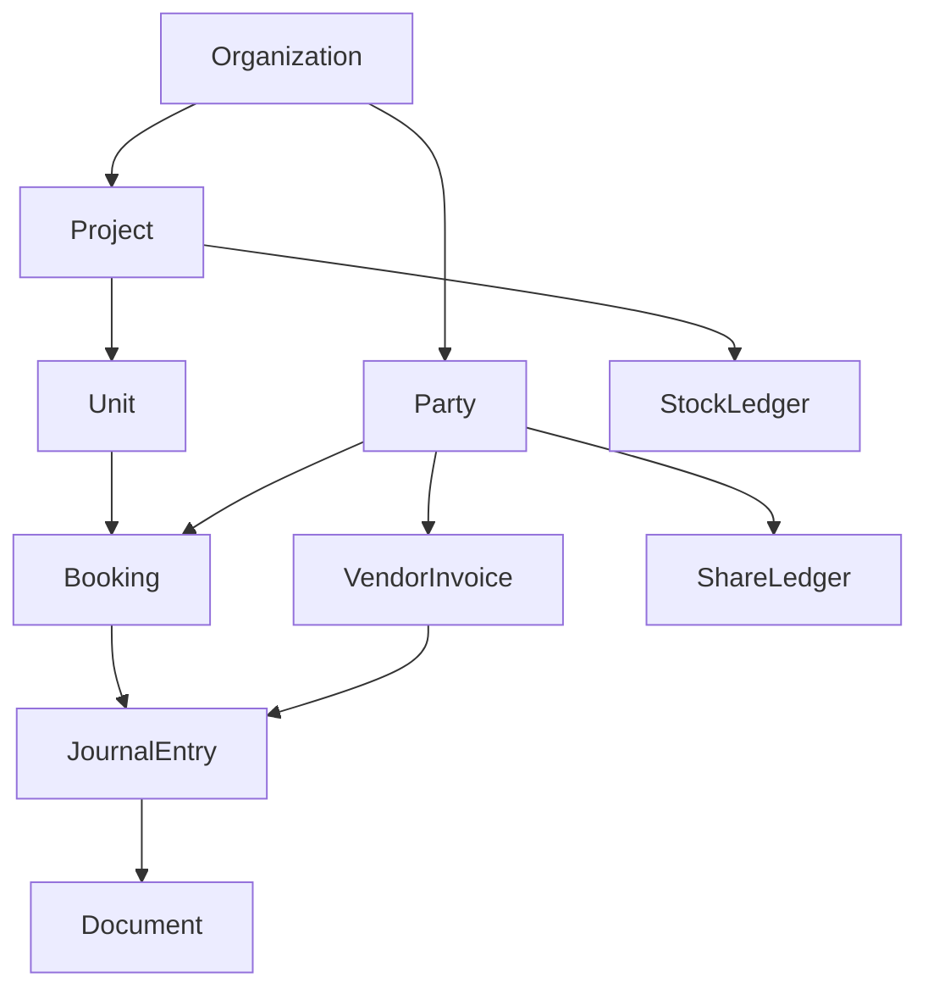
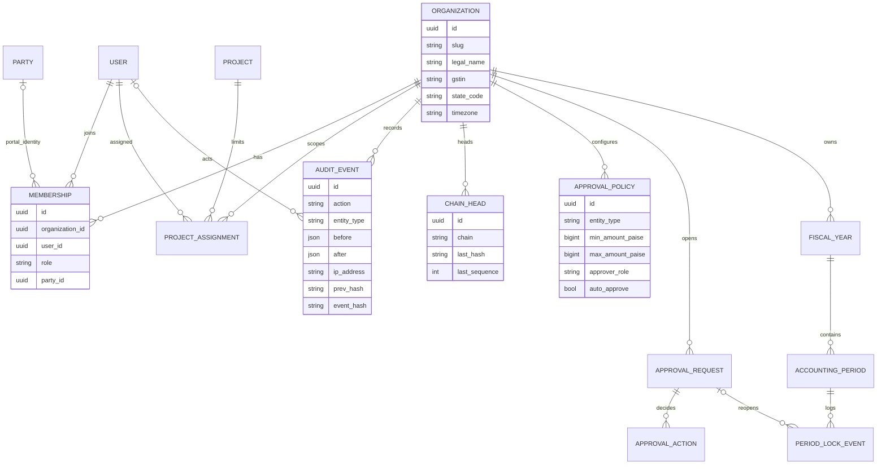
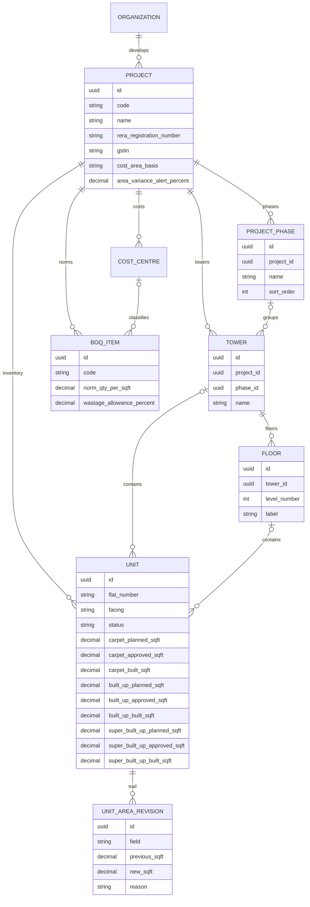
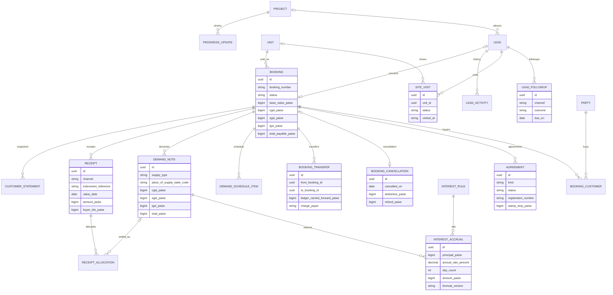
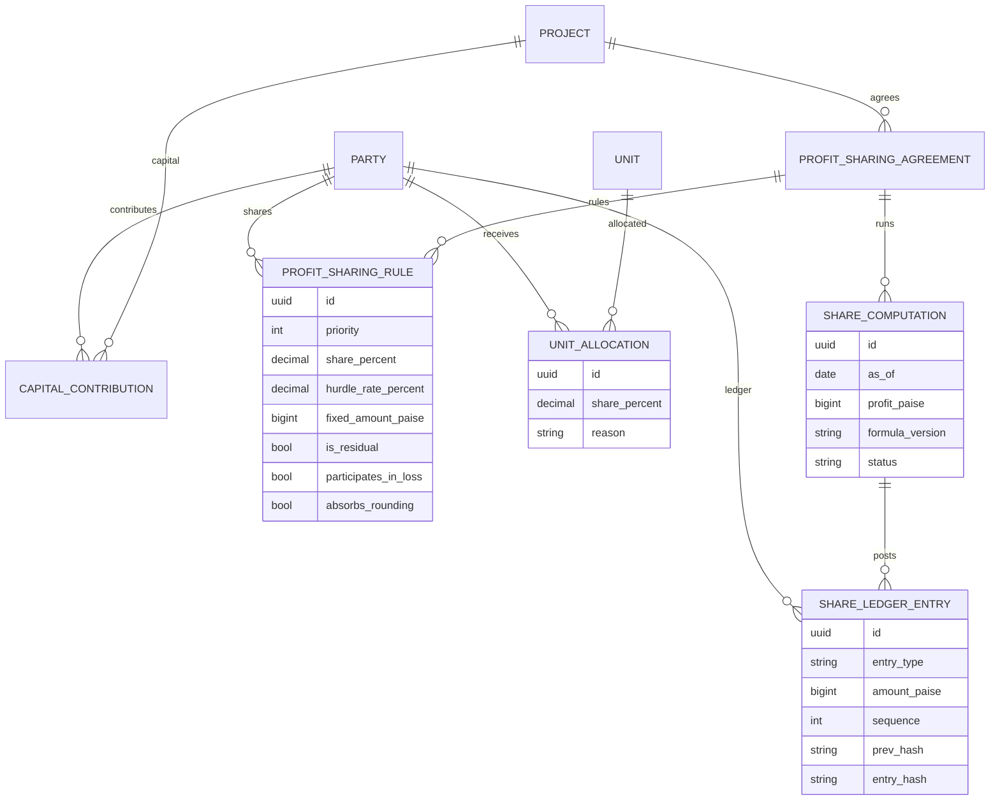
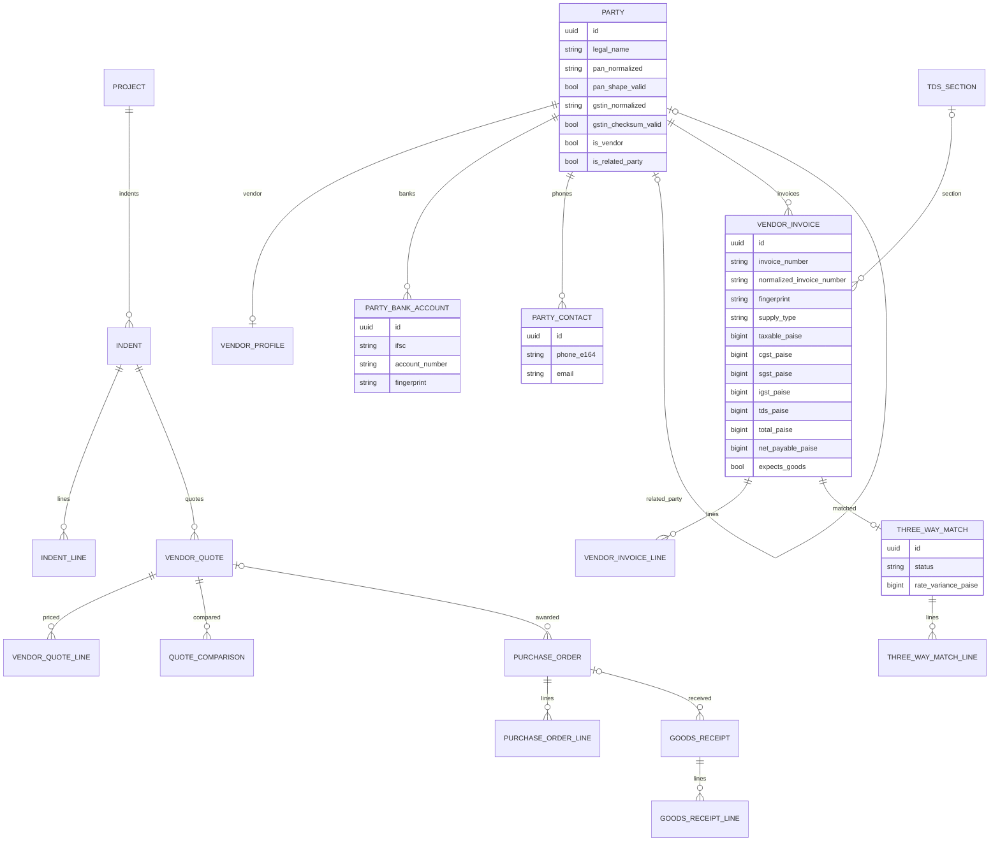
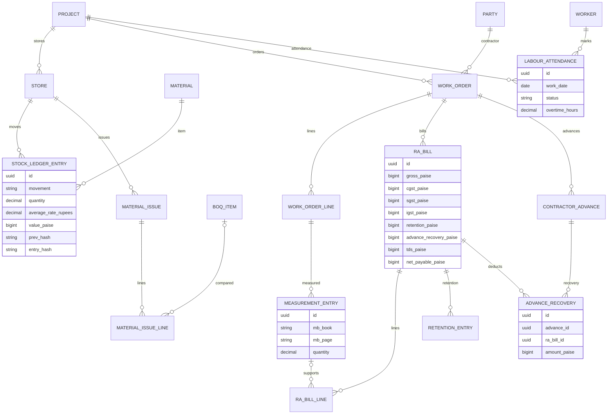
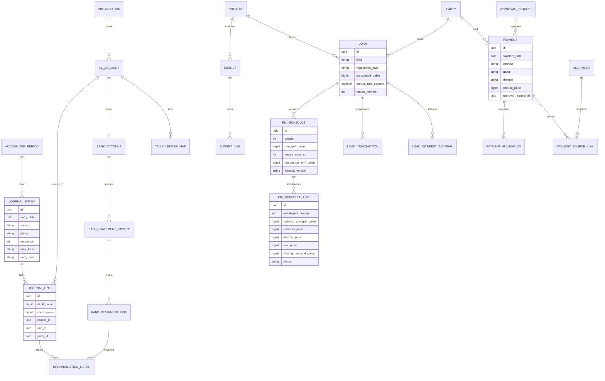
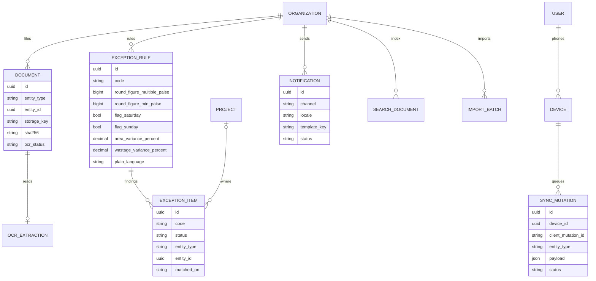

# SiteLedger entity diagram

The Prisma schema is the field-complete model. These diagrams show how the modules connect, and they repeat the fields the product brief names. Attribute types are shortened to `uuid`, `string`, `int`, `bigint`, `decimal`, `date`, `bool`, and `json`. Money columns are paise.

## Identity, tenancy, audit

`User`, `Account`, `Session`, and `VerificationToken` follow Auth.js. `GstRate` and `TdsSection` are global slabs. None of those six tables carry `organization_id`.

## Projects, phases, towers, floors, units

A plot can omit tower and floor. Floor level 0 is ground. Negative levels are basements. Every area change also inserts a revision. Variance alerts read the current unit columns.

## Sales CRM

Receipts stay on the old booking after a transfer. The new booking opens with `ledger_carried_forward_paise`. Buyer TDS is entered. It is not calculated from section 194-IA.

## Partners and investors

## Vendors and procurement

A draft goods receipt may have no purchase order yet, so a site phone can record material received and link the order later. Quote comparison is append-only and requires a reason.

## Materials, contractors, labour

## Finance

`JournalEntry` is the single money book. Receipts, payments, invoices, RA bills, interest, loans, capital, retention, advances, and Tally drafts all point at one journal row. Status is not part of the hash.

## Documents, exceptions, sync, search

Exception codes include unmatched bank lines, payments without invoices, invoices without a GRN, area and material mismatches, round-figure payments, and weekend payments. `SearchDocument` is a Cmd-K projection. It is not a financial record.
